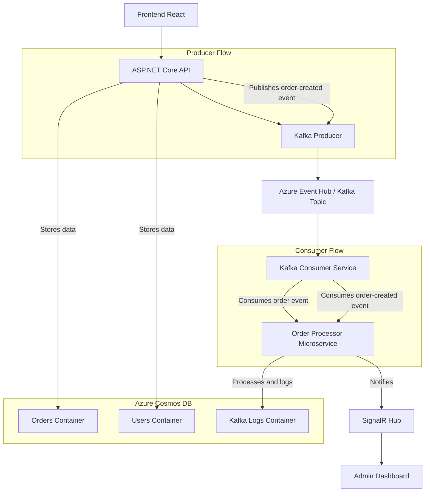

# 🛒 Real-Time Distributed Order Management System

A full-stack **E-Commerce Order Management Platform** built with **ASP.NET Core, CosmosDB, Kafka, SignalR, and React**, deployed on **Azure**.  
The system supports real-time order updates, admin dashboards, and scalable event-driven processing with Kafka.

---

## 🚀 Overview

This project demonstrates how to build a modern, cloud-ready, event-driven system using **.NET and Azure**. It includes:

- 📦 Real-time order placement and tracking  
- 🔄 Event-driven processing with Apache Kafka / Azure Event Hubs  
- 📊 Admin dashboard with analytics and Kafka log monitoring  
- 🔐 Secure authentication with JWT  
- ☁️ Cloud deployment to Azure App Services  

---

## ✨ Features

### ✅ User Features
- Place new orders  
- Update and Delete orders  
- Secure login & authentication  

### ✅ Admin Features
- Manage & update order status  
- Kafka logs dashboard for event monitoring  
- Analytics dashboard with charts (orders by status, user activity)  

### ✅ Architecture Features
- Event-driven with **Kafka Producer + Consumer**  
- Orders & logs persisted in **Cosmos DB**  
- Scalable microservice-friendly design  
- Cloud-native deployment on **Azure**  

---

## 🏗️ Tech Stack

- **Frontend**: React, TypeScript, TailwindCSS  
- **Backend**: ASP.NET Core 8, SignalR, EF Core, JWT Auth  
- **Messaging**: Apache Kafka (Azure Event Hub)  
- **Database**: CosmosDB (Orders), Cosmos DB (Logs)  
- **Cloud**: Azure App Services, Azure Event Hub  
- **Other Tools**: Swagger (API docs), Docker (containerization)  

---

## 📊 Architecture Diagram

